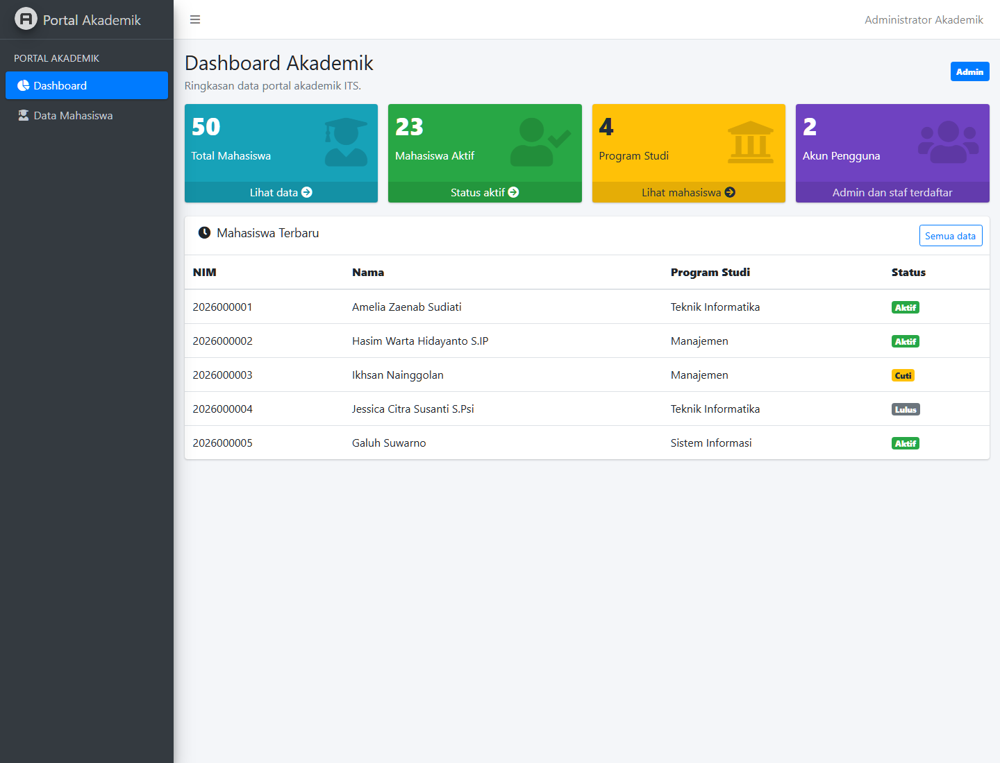

# Portal Akademik ITS

Dashboard backoffice Laravel 9 dengan AdminLTE, autentikasi Laravel Breeze, dan RBAC database Spatie Permission.

## Fitur

- Halaman dashboard dan data mahasiswa hanya dapat dibuka setelah login dan verifikasi email.
- Peran dan izin disimpan pada tabel Spatie: `Admin` memiliki akses penuh, sedangkan `Staf` hanya dapat melihat data.
- Tombol dan route hapus data hanya tersedia untuk peran `Admin`; controller tetap memeriksa role.
- Dashboard menghitung total mahasiswa, mahasiswa aktif, program studi, dan akun dari database.
- Pencarian NIM/nama/prodi/email serta filter status memakai query kondisional `when()`; pagination mempertahankan filter melalui `withQueryString()`.
- Seeder membuat dua akun demo dan 50 data mahasiswa Faker.
- Halaman login punya tombol masuk demo Admin dan Staf.

## Instalasi

Persyaratan: PHP 8.0+, Composer, Node.js/npm, dan MySQL/MariaDB atau SQLite.

```bash
composer install
copy .env.example .env
php artisan key:generate
```

Atur kredensial database di `.env`, lalu siapkan skema dan data demo:

```bash
php artisan migrate --seed
npm install
npm run build
php artisan serve
```

Buka `http://127.0.0.1:8000/login` untuk login demo. Halaman portal lama tetap tersedia di `/`. Untuk SQLite, buat file `database/database.sqlite`, lalu set `DB_CONNECTION=sqlite` dan `DB_DATABASE` ke path file itu pada `.env`.

## Akun demo

| Peran | Email | Password |
| --- | --- | --- |
| Admin | `admin@kampus.test` | `Admin123!` |
| Staf | `staf@kampus.test` | `Staf123!` |

Seeder menandai kedua akun sebagai terverifikasi supaya demo langsung dapat masuk ke dashboard. Gunakan tombol login demo di halaman awal.

## Matriks akses

| Fitur | Admin | Staf |
| --- | --- | --- |
| Dashboard dan statistik | Ya | Ya |
| Lihat dan cari mahasiswa | Ya | Ya |
| Tambah atau edit mahasiswa | Ya | Tidak |
| Hapus mahasiswa | Ya | Tidak |

Pemetaan permission berada di `database/seeders/DatabaseSeeder.php`. Setelah mengubah seeder, jalankan ulang `php artisan db:seed`.

## Screenshot dashboard



## Catatan keamanan Git

Jangan commit `.env` atau `vendor/`. Keduanya sudah dikecualikan oleh `.gitignore`; commit `.env.example` sebagai template konfigurasi.
